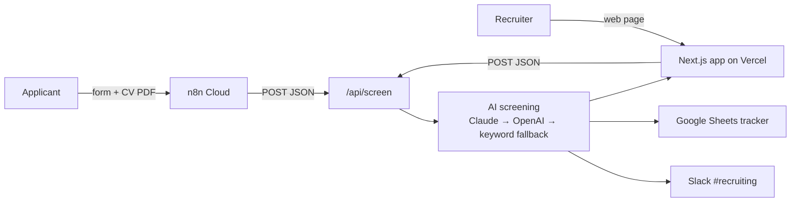

# Candidate Screener: AI-powered CV screening automation

An AI automation that screens job applications. A candidate applies with a CV and a job is selected. AI compares the CV with the job, then returns a match score, matched and missing skills, a short summary and interview questions. The recruiting team gets the result automatically in **Slack** and **Google Sheets**.

Built as part of a technical assessment for an **AI Operations Specialist** role.

|                                                     | Link                                                                                                 |
| --------------------------------------------------- | ---------------------------------------------------------------------------------------------------- |
| 🌐 **Live app (recruiters)**                        | https://candidate-screener-three.vercel.app                                                          |
| 📝 **Live application form (applicants, n8n)**      | https://stivdaiu.app.n8n.cloud/form/apply _(n8n Cloud trial, active until 6 December 2026)_          |
| 🎥 **Demo video**                                   | _add link_                                                                                           |
| 📊 **Candidate tracker (Google Sheets, view-only)** | https://docs.google.com/spreadsheets/d/1AZnUZCc7Zyrr-y77H6dLC_4S08bF0hoim3KaKoOODQI/edit?usp=sharing |

### Try it in 30 seconds

1. Open the [live app](https://candidate-screener-three.vercel.app).
2. Click **Load sample data**, then **Screen candidate**.
3. You get a score, a recommendation, matched and missing skills, and 3 interview questions. The status line shows which AI engine answered and whether Slack and Google Sheets were notified.
4. Open the [candidate tracker](https://docs.google.com/spreadsheets/d/1AZnUZCc7Zyrr-y77H6dLC_4S08bF0hoim3KaKoOODQI/edit?usp=sharing) and refresh it. Your screening appears as a new row.

Or apply like a real candidate through the [application form](https://stivdaiu.app.n8n.cloud/form/apply). Use the [sample CV](https://candidate-screener-three.vercel.app/sample-cv.pdf) (a fictional candidate). You'll only see "Thanks for applying". The screening happens behind the scenes for the recruiters.

---

## The problem and the solution

Recruiters spend hours reading CVs to decide who fits a role. This is a repetitive task, so it's a good fit for AI automation.

The app works in two modes that share one API:

- **Automatic mode (applicants):** a candidate fills in an n8n form and uploads a PDF CV. n8n extracts the text and calls the screening API. The recruiters receive the result in Slack and Google Sheets. Nobody has to click anything.
- **Manual mode (recruiters):** a recruiter picks a saved job, uploads or pastes a CV in the web app, and sees the full result on screen.



---

## 1. Working application

- **Web app:** https://candidate-screener-three.vercel.app
- **Application form (n8n):** https://stivdaiu.app.n8n.cloud/form/apply
- **Candidate tracker (Google Sheets):** https://docs.google.com/spreadsheets/d/1AZnUZCc7Zyrr-y77H6dLC_4S08bF0hoim3KaKoOODQI/edit?usp=sharing
- **Source code:** this repository
- **Demo video:** _add link_

## 2. AI tools used

| Tool                       | How it helped                                                                                                                                                                                                                                                                                                                                                                     |
| -------------------------- | --------------------------------------------------------------------------------------------------------------------------------------------------------------------------------------------------------------------------------------------------------------------------------------------------------------------------------------------------------------------------------- |
| **Claude (claude.ai)**     | My AI coding assistant. I used it to plan the solution against the job requirements, help write the code, and debug errors. I made the product and design decisions, built and ran every step myself, set up all the services (Slack, Google Sheets, n8n, GitHub, Vercel), and tested and reviewed the results. That's how I found and fixed issues like the prompt fairness bug. |
| **Claude API (Anthropic)** | The main AI engine inside the app. It screens each CV and returns structured JSON.                                                                                                                                                                                                                                                                                                |
| **OpenAI API**             | An automatic backup engine if Claude is unavailable.                                                                                                                                                                                                                                                                                                                              |
| **n8n**                    | Low-code automation for the applicant flow: form → PDF text extraction → API call, with retries.                                                                                                                                                                                                                                                                                  |

**What I learned about working with AI tools:** AI output must be **verified**, not trusted blindly. I reviewed the screening results myself and found a fairness bug in my first prompt (see _Challenges_). I also built validation and fallbacks into the code, so a bad or missing AI answer never breaks the automation.

## 3. Technical explanation

### Technologies

| Layer         | Technology                                                                                         |
| ------------- | -------------------------------------------------------------------------------------------------- |
| Web app + API | **Next.js** (App Router) + **TypeScript** + **Tailwind CSS**                                       |
| Validation    | **Zod** (one shared schema for input, AI output and the frontend)                                  |
| AI            | **Anthropic SDK** (Claude, structured outputs) and **OpenAI SDK** (JSON Schema structured outputs) |
| PDF reading   | **unpdf**                                                                                          |
| Notifications | **Slack** Incoming Webhook, **Google Sheets** via a Google Apps Script web app                     |
| Automation    | **n8n** (Form Trigger → Extract from File → HTTP Request)                                          |
| Tests         | **Vitest** (11 unit tests)                                                                         |
| Hosting       | **Vercel** (auto-deploys on every push to GitHub)                                                  |

### How a screening works (`POST /api/screen`)

1. **Rate limit:** each visitor can run at most 10 screenings per hour on the public demo.
2. **Validate input** with Zod. Bad requests get a clear `400` error, for example `cvText: CV is too short`.
3. **Resolve the job:** either a full `jobDescription`, or a `jobId` for a saved job (used by n8n).
4. **Screen with AI:** Claude first, then OpenAI if Claude fails, then a free **keyword-matching fallback** if both fail. The automation never stops.
5. **Validate the AI output** against the same Zod schema, and **enforce business rules in code** (score ≥ 75 → shortlist, 50–74 → maybe, < 50 → reject) instead of trusting the model.
6. **Notify the team** in Slack and Google Sheets **in parallel** (`Promise.allSettled`). If one fails, the screening still succeeds and the failure becomes a warning.
7. **Return** the result with metadata: the engine used, the duration, the delivery status and any warnings.

### Key design decisions

- **One data contract** (`src/lib/schema.ts`): the page, the API and the AI output all use the same Zod schemas, so they can't drift apart.
- **Structured output + validation:** the AI must return JSON that matches a schema, and the code validates it again.
- **Resilience:** two AI providers plus an offline fallback, timeouts and retries on every external call, and failure isolation between integrations.
- **Each endpoint does one job:** `/api/extract-cv` turns PDFs into text, and `/api/screen` only ever receives text. That's why the web page and n8n can share the same webhook.
- **Security:**
  - API keys stay **server-side** (Vercel environment variables) and are never sent to the browser.
  - **Prompt-injection guard:** the prompt treats the CV and job text as data, not instructions.
  - **Formula-injection guard:** cells starting with `= + - @` are neutralised before they reach Google Sheets.
  - Slack special characters are escaped, so a CV can't inject links into messages.
  - The Google Sheets endpoint is protected by a **shared secret**.
  - A **per-visitor rate limit** protects API costs on the public demo.
- **Responsible AI:** the prompt tells the model to ignore name, gender, age, nationality and photo, and to use only evidence in the CV. The result is a **recommendation for a human recruiter**, not an automatic decision.

### Prompt engineering (`src/lib/prompt.ts`)

The prompt went through three versions, based on reviewing real output:

| Version | Problem                                                                                                                                             | Change                                                                  |
| ------- | --------------------------------------------------------------------------------------------------------------------------------------------------- | ----------------------------------------------------------------------- |
| v1      | When the job asked for _"Python **or** JavaScript"_ and the CV had Python, "JavaScript" was still listed as missing. That made scores unfairly low. | Added a rule about alternative requirements.                            |
| v2      | Partly fixed: JavaScript was gone, but "Claude or Gemini" and "Make or n8n" were still listed as missing.                                           | Added **concrete examples** and a strict definition of a missing skill. |
| v3      | ✅ Missing skills now contain only real gaps, and matched skills say how each requirement is met (e.g. "AI tools (ChatGPT)").                       |                                                                         |

### Project structure

```
src/
  app/
    page.tsx                  Recruiter web page
    api/screen/route.ts       Screening webhook (used by the page and n8n)
    api/extract-cv/route.ts   PDF → text
  lib/
    schema.ts                 Zod schemas (the data contract)
    prompt.ts                 System prompt + JSON schema for the AI
    screen.ts                 Provider chain: Claude → OpenAI → keyword fallback
    providers/anthropic.ts    Claude (native structured outputs)
    providers/openai.ts       OpenAI (JSON Schema structured outputs)
    fallback.ts               Offline keyword matching
    recommendation.ts         Score → recommendation business rule
    jobs.ts                   Saved job descriptions
    rate-limit.ts             Per-visitor rate limit
    integrations/             Slack + Google Sheets (run in parallel)
    __tests__/                Unit tests
n8n/candidate-screening-workflow.json   Importable n8n workflow
google-apps-script/Code.gs              Script that writes rows into the Google Sheet
public/sample-cv.pdf                    Fictional sample CV
```

## 4. Challenges and solutions

| #   | Challenge                                                                                                                                                                                                | How I solved it                                                                                                                                                                                                                                                                                                                                                                    |
| --- | -------------------------------------------------------------------------------------------------------------------------------------------------------------------------------------------------------- | ---------------------------------------------------------------------------------------------------------------------------------------------------------------------------------------------------------------------------------------------------------------------------------------------------------------------------------------------------------------------------------- |
| 1   | **Claude rejected every request:** _"tool_choice type 'tool' is not supported for this model"_. The forced-tool technique I used for structured output doesn't work on the newest Claude models.         | The **OpenAI backup kicked in automatically**, so users still got results. I read the error in the server logs, checked the current SDK, and switched to Claude's **native structured outputs** (`output_config.format`). I also set `effort: "low"`, since screening is a focused task. Screening time dropped from about 8.6 s (failed Claude call, then OpenAI) to about 4–5 s. |
| 2   | **Prompt fairness bug:** alternative requirements ("X or Y") were counted as missing skills.                                                                                                             | Found by reviewing real output. Fixed in two iterations (see _Prompt engineering_): a general rule wasn't enough, and concrete examples fixed it.                                                                                                                                                                                                                                  |
| 3   | **Build error:** the newest Next.js rejected `export const runtime = "nodejs"` in the API routes.                                                                                                        | Removed it. Node.js is already the default runtime.                                                                                                                                                                                                                                                                                                                                |
| 4   | **`npm install vitest` failed with `ERESOLVE`** because of a peer-dependency conflict on `@types/node`.                                                                                                  | Installed `vitest` together with `@types/node@22`.                                                                                                                                                                                                                                                                                                                                 |
| 5   | **The n8n form returned 404.** I tested the workflow on a real n8n instance before shipping it.                                                                                                          | In the current Form Trigger version, the custom path must be set under `options.path`, not at the top level.                                                                                                                                                                                                                                                                       |
| 6   | **n8n wouldn't install locally:** first an npm cache lock error (`ECOMPROMISED`), then a native dependency failed to compile because I was on **Node 25** (a non-LTS release with no prebuilt binaries). | Cleaned the npm cache. Since the app was already deployed, I moved to **n8n Cloud**, which also gives reviewers a public form to test. (Locally, the fix is Node 22 LTS, the same runtime as Vercel.)                                                                                                                                                                              |
| 7   | **A public demo with my API keys** could be abused (cost, Slack spam).                                                                                                                                   | Added a **per-visitor rate limit** (10 screenings per hour) with a friendly `429` message.                                                                                                                                                                                                                                                                                         |
| 8   | **Circular import:** both `screen.ts` and `fallback.ts` needed the score → recommendation rule.                                                                                                          | Moved it into its own module, `recommendation.ts`.                                                                                                                                                                                                                                                                                                                                 |

---

## API

### `POST /api/screen`

```json
{
  "jobId": "ai-operations-specialist",
  "cvText": "Maria Rossi ... (CV text)",
  "candidateName": "Maria Rossi",
  "candidateEmail": "maria.rossi@example.com",
  "notify": true
}
```

| Field                                         | Required | Description                                                          |
| --------------------------------------------- | -------- | -------------------------------------------------------------------- |
| `cvText`                                      | ✅       | CV text (50–30,000 characters)                                       |
| `jobDescription` _or_ `jobId`                 | ✅       | Full job description, or a saved job id/title from `src/lib/jobs.ts` |
| `candidateName`, `candidateEmail`, `jobTitle` |          | Shown in Slack and Google Sheets                                     |
| `notify`                                      |          | `false` skips Slack and Sheets (default `true`)                      |

Response (shortened):

```json
{
  "result": {
    "candidateName": "Maria Rossi",
    "matchScore": 84,
    "recommendation": "shortlist",
    "summary": "Maria has over two years of hands-on automation experience...",
    "matchedSkills": [
      "Automation tools (Zapier)",
      "AI tools (ChatGPT)",
      "Prompt writing"
    ],
    "missingSkills": ["APIs and webhooks", "Building AI assistants"],
    "interviewQuestions": ["Walk me through one of your Zapier automations..."]
  },
  "meta": {
    "engine": "anthropic",
    "durationMs": 4138,
    "notifications": { "slack": "sent", "sheets": "sent" },
    "warnings": []
  }
}
```

Try it from PowerShell:

```powershell
$body = @{
  jobId  = "ai-operations-specialist"
  cvText = "I built Zapier automations connecting Slack and Google Sheets, and wrote Python reporting scripts for two years."
  notify = $false
} | ConvertTo-Json
Invoke-RestMethod -Uri https://candidate-screener-three.vercel.app/api/screen -Method Post -ContentType "application/json" -Body $body
```

### `POST /api/extract-cv`

`multipart/form-data` with a `file` field (PDF, max 5 MB). Returns `{ "text": "...", "pages": 1 }`.

---

## Run it locally

**Requirements:** Node.js 22 LTS, plus an Anthropic and/or OpenAI API key. Slack and Google Sheets are optional.

```bash
git clone https://github.com/stivdaiu/candidate-screener.git
cd candidate-screener
npm install
cp .env.example .env.local   # then fill in your keys
npm run dev                  # http://localhost:3000
npm test                     # 11 unit tests
```

### Environment variables

| Variable                                            | Purpose                                                                    |
| --------------------------------------------------- | -------------------------------------------------------------------------- |
| `ANTHROPIC_API_KEY`, `OPENAI_API_KEY`               | AI providers (one is enough; without either, the keyword fallback is used) |
| `AI_PROVIDER`                                       | Which provider to try first: `anthropic` or `openai`                       |
| `ANTHROPIC_MODEL`, `OPENAI_MODEL`                   | Model IDs (change them here, not in the code)                              |
| `SLACK_WEBHOOK_URL`                                 | Slack Incoming Webhook URL                                                 |
| `GOOGLE_SHEETS_WEBHOOK_URL`, `GOOGLE_SHEETS_SECRET` | Google Apps Script web app URL + shared secret                             |
| `RATE_LIMIT_PER_HOUR`                               | Max screenings per visitor per hour (`0` = no limit)                       |

### Integrations setup

- **Slack:** create an app at api.slack.com/apps → **Incoming Webhooks** → add a webhook to your channel → copy the URL into `SLACK_WEBHOOK_URL`.
- **Google Sheets:** open a Sheet → **Extensions → Apps Script** → paste [`google-apps-script/Code.gs`](google-apps-script/Code.gs) → set `SECRET` → **Deploy → Web app** (Execute as: Me, Access: Anyone) → copy the URL into `GOOGLE_SHEETS_WEBHOOK_URL` and the secret into `GOOGLE_SHEETS_SECRET`.
- **n8n:** **Import from File** → [`n8n/candidate-screening-workflow.json`](n8n/candidate-screening-workflow.json) → set the URL in **Screen with AI** → **Publish**. The form is then at `https://<your-n8n>/form/apply`.

## Limitations and next steps

- **Rate limit storage:** the limit is in memory, so on Vercel it applies per server instance. Production would use a shared store such as Redis.
- **n8n shares one rate limit:** every form submission reaches the API from n8n's server. Next step: a private API key for trusted automations.
- **No login on the recruiter page.** Fine for a demo. Production would add authentication.
- **Scanned PDFs** (images without text) aren't supported yet. Next step: OCR.
- **Results aren't stored in a database.** Google Sheets acts as the tracker for now.
- **Human in the loop:** the AI gives a recommendation, and a recruiter makes the decision.
